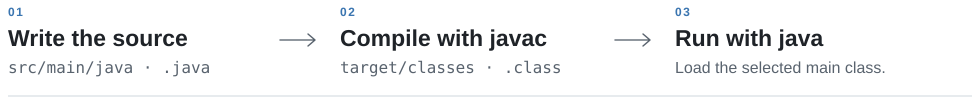

<h1 id="java_lab">
  <a href="https://www.java.com/"></a>
  <picture>
    <source media="(prefers-color-scheme: dark)" srcset="assets/readme/java-title-dark.svg">
    
  </picture>
</h1>

**Java concepts, runnable experiments, and the things I want to remember.**

I keep my Java practice here so I can work through language questions in small programs, revisit mistakes, and carry a clearer understanding back into my **backend projects**.

<details>
<summary><strong>About this lab</strong></summary>

A framework can hide a language question behind configuration and application code. Here I can isolate it: two object references, one collection, a decimal calculation, or a shared counter.

I study Java and DSA alongside application development, usually through focused weekend sessions. This notebook keeps the language work easy to pick up again, with Git preserving the attempts and corrections.

</details>

<p>
  <a href="#java-learning-map">Learning&nbsp;map</a> &nbsp;·&nbsp;
  <a href="#recorded-experiments">Experiments&nbsp;&amp;&nbsp;revision</a> &nbsp;·&nbsp;
  <a href="#working-setup">Setup</a> &nbsp;·&nbsp;
  <a href="#beyond-java-lab">Beyond&nbsp;the&nbsp;lab</a>
</p>

<h2 id="java-learning-map">Java learning map</h2>

Language and API topics for backend work, from everyday Java to runtime behaviour.

<details>
<summary><strong>01 · Language fundamentals and OOP</strong></summary>

**Core**

- Types, control flow, methods, arrays, strings, object identity, and logical equality.
- Classes, constructors, interfaces, inheritance, polymorphism, and composition.

**Applied:** enums, records, immutable objects, and defensive copying.

</details>

<details>
<summary><strong>02 · Collections, generics, and exceptions</strong></summary>

**Core**

- Choosing a `List`, `Set`, `Map`, or queue; iteration and collection behaviour.
- Equality and hashing contracts — `equals()` and `hashCode()`.
- Generic types, bounds, and wildcards.
- Checked and unchecked exceptions, propagation, wrapping, and useful error context.

**Applied:** mutable keys, ordering, `Comparable`, and `Comparator`.

**Deep dive:** type erasure and its effects on generic code.

</details>

<details>
<summary><strong>03 · Functional Java and platform APIs</strong></summary>

**Core**

- Lambdas, method references, streams, collectors, `Optional`, and comparisons with loops.
- `java.time` — instants, dates, durations, time zones, and a controllable `Clock`.
- `BigDecimal` — precision, scale, rounding, and comparisons in money calculations.

**Applied**

- File I/O, encodings, `Path`, `Files`, and `try-with-resources`.
- Small HTTP client and JDBC exercises, independent of a framework.

</details>

<details>
<summary><strong>04 · Concurrency and shared state</strong></summary>

**Applied**

- Threads, race conditions, visibility, synchronization, and atomic operations.
- Executors, futures, cancellation, and concurrent collections.

**Deep dive:** `CompletableFuture`, virtual threads, and comparisons between concurrency approaches.

</details>

<details>
<summary><strong>05 · JVM, diagnostics, and internals</strong></summary>

**Applied**

- Source and bytecode, stack frames, heap objects, references, and garbage collection basics.
- Reading stack traces and inspecting a running program with JDK tools.

**Deep dive**

- Class loading, initialization, reflection, and annotations.
- The Java Memory Model, happens-before relationships, and GC diagnostics.

</details>

<details>
<summary><strong>06 · Modern Java and measured experiments</strong></summary>

**Applied**

- Switch expressions, pattern matching, and sealed types in small examples.
- JDK version comparisons and the requirements of preview features.

**Deep dive**

- Inspecting generated bytecode with `javap` and comparing implementations.
- Performance experiments with JMH, warmup, repeatable inputs, and stated limits.

</details>

<h2 id="recorded-experiments"><a id="java-in-practice"></a><a id="revision-notes"></a>Experiments &amp; revision</h2>

I start with a prediction, test it in a small program, and try an edge case. When I return to it, I explain the result before opening my notes.

<details>
<summary><strong>Questions worth testing</strong></summary>

| Question | Comparison to make |
| :--- | :--- |
| When do `==` and `equals()` disagree? | Shared references, equal values, and separate objects. |
| What if a `HashMap` key changes? | Lookup before and after changing equality-related state. |
| Can equal decimal values compare differently? | `BigDecimal.equals()` and `compareTo()`, with different scales. |
| When does a resource close? | Normal completion, an exception, and cleanup that also fails. |

**Checks across topics:** normal input, boundaries, and expected exceptions. Add JUnit tests when repeatable checks help preserve the behaviour.

**Things Java taught me:** keep the initial assumption, observed result, explanation, and useful edge case beside the source, with the exact run command and JDK version.

</details>

<h2 id="working-setup">Working with the lab</h2>

**JDK 25 · Maven · IntelliJ IDEA · Git**

The [POM](pom.xml) sets compiler source and target to **25**, with no preview features enabled.

<picture>
  <source media="(prefers-color-scheme: dark) and (max-width: 600px)" srcset="assets/readme/java-execution-mobile-dark.svg">
  <source media="(max-width: 600px)" srcset="assets/readme/java-execution-mobile-light.svg">
  <source media="(prefers-color-scheme: dark)" srcset="assets/readme/java-execution-dark.svg">
  
</picture>

<p><sub>Standard Maven layout · JDK 25: <a href="https://docs.oracle.com/en/java/javase/25/docs/specs/man/javac.html">javac</a> · <a href="https://docs.oracle.com/en/java/javase/25/docs/specs/man/java.html">java</a>.</sub></p>

<details>
<summary><strong>Open and check</strong></summary>

```sh
git clone https://github.com/codewithmahad/JAVA_LAB.git
cd JAVA_LAB
java -version
javac -version
mvn -version
mvn validate
```

`mvn validate` checks the project configuration.

Use JDK 25 for both the project and Maven. There's no Maven Wrapper, so terminal commands need a local Maven installation. In IntelliJ IDEA, open `pom.xml` and select JDK 25 for the project and Maven runner.

</details>

<details>
<summary><strong>References within reach</strong></summary>

- **API contracts:** [Java SE 25 API](https://docs.oracle.com/en/java/javase/25/docs/api/index.html) · [Dates and time](https://docs.oracle.com/en/java/javase/25/docs/api/java.base/java/time/package-summary.html) · [BigDecimal](https://docs.oracle.com/en/java/javase/25/docs/api/java.base/java/math/BigDecimal.html).
- **Language and runtime:** [Java Language Specification](https://docs.oracle.com/javase/specs/jls/se25/html/index.html) · [JVM Specification](https://docs.oracle.com/javase/specs/jvms/se25/html/index.html).
- **Worked explanations:** [Dev.java](https://dev.java/learn/). **Testing reference:** [JUnit User Guide](https://docs.junit.org/current/user-guide/).

</details>

<h2 id="beyond-java-lab">
  <picture>
    <source media="(prefers-color-scheme: dark)" srcset="assets/readme/lab-notebook-dark.svg">
    
  </picture>
  Beyond the lab
</h2>

The Java work here sits alongside **DSA** for problem solving and comparing approaches, and **SQL** for modelling and querying data. I want that practice to show up in the backend code I write, and in how well I can explain it.

<p>
  <a href="https://github.com/codewithmahad/JAVA_LAB"><picture><source media="(prefers-color-scheme: dark)" srcset="assets/readme/lab-java-dark.svg"></picture></a>
  <a href="https://github.com/codewithmahad/DSA_LAB"><picture><source media="(prefers-color-scheme: dark)" srcset="assets/readme/lab-dsa-dark.svg"></picture></a>
  <a href="https://github.com/codewithmahad/SQL_LAB"><picture><source media="(prefers-color-scheme: dark)" srcset="assets/readme/lab-sql-dark.svg"></picture></a>
</p>

<p><sub>For my OS coursework:</sub> <a href="https://github.com/codewithmahad/LINUX_LAB"><picture><source media="(prefers-color-scheme: dark)" srcset="assets/readme/lab-linux-dark.svg"></picture></a></p>

<p>
  <a href="https://github.com/codewithmahad">GitHub</a> &nbsp;·&nbsp;
  <a href="https://shaikhmahad.vercel.app/">Portfolio</a>
  <br clear="right">
</p>

<p><sub><a href="assets/README.md">Artwork credits</a> &nbsp;·&nbsp; <a href="#java_lab">Back to top ↑</a></sub></p>
